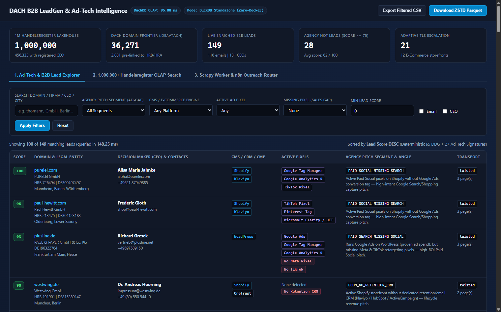
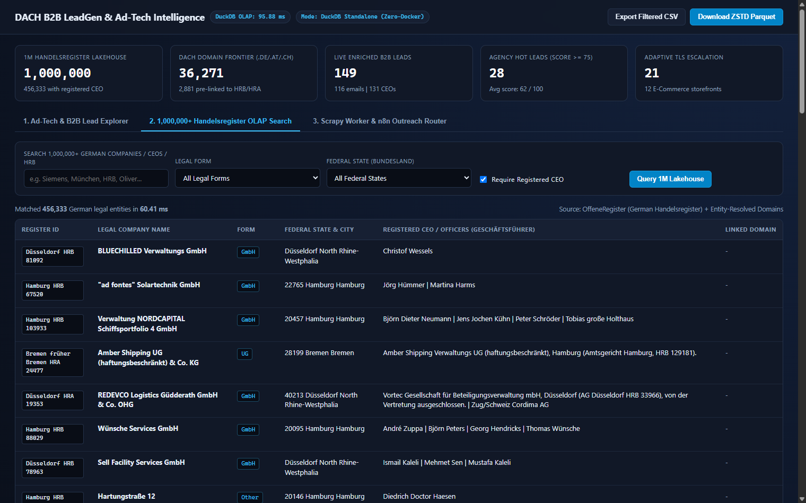
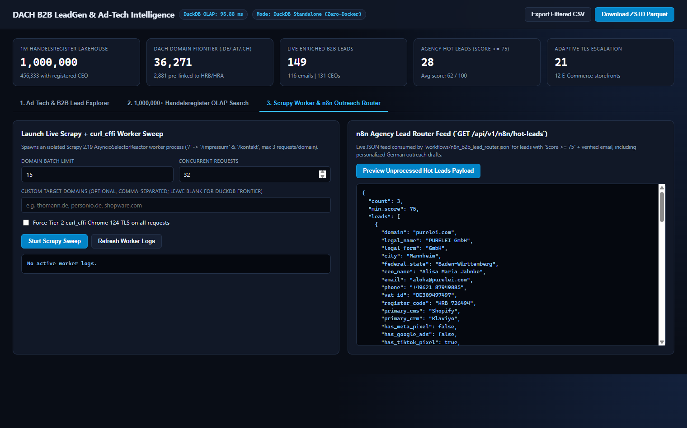

# DACH B2B LeadGen & Ad-Tech Intelligence Crawler


Industrial-scale (**1,000,000+ rows**) distributed B2B Lead Generation, German **Impressum (§5 DDG)** Decision-Maker, and **Ad-Tech Pixel Intelligence** platform built for the DACH market (`.de`, `.at`, `.ch`).

Rather than scraping a single website linearly, this engine combines **1,000,000+ official German Handelsregister corporate records** (`OffeneRegister`) with high-concurrency broad-domain crawling (`Scrapy` + `scrapy-redis` + adaptive `curl_cffi` Chrome 124 TLS escalation) to detect actionable **"Ad-Spend Gaps"** — identifying verified companies actively spending on one ad channel (e.g., `Google Ads` on `Shopware` / `Shopify`) while missing high-ROI retargeting or retention infrastructure (`Meta Pixel`, `TikTok Pixel`, `Klaviyo`, `HubSpot`), complete with verified `Geschäftsführer` (CEO) names and corporate emails.

---

## Live Console Preview

### 1. Ad-Tech & B2B Lead Explorer (`<150 ms` Filtered Search)


### 2. 1,000,000+ Handelsregister Columnar OLAP Search (`~60 ms` over 1M Rows)


### 3. Scrapy Worker Control & `n8n` Agency Outreach Router Feed


---

## System Architecture

```mermaid
flowchart LR
    subgraph Seed["1. 1M+ Seed & Frontier Layer"]
        OR["OffeneRegister pbzip2 Stream (1,000,000+ DE Companies & CEOs)"]
        TR["Tranco Top-1M (.de / .at / .ch Commercial Domains)"]
        ER["Vectorized Entity Resolution (HRB/HRA & Brand Slug Join)"]
        OR --> ER
        TR --> ER
    end

    subgraph Crawl["2. Distributed Scrapy 2.19 Engine"]
        RD["Redis 7 URL Frontier & RFPDupeFilter (scrapy-redis)"]
        TW["Tier 1: Twisted Async HTTP11 (Fast-Path, 64-256 Concurrent)"]
        CF["Tier 2: Custom Async curl_cffi Handler (Chrome 124 TLS on 403/429/503)"]
        EX["Lexbor §5 DDG Impressum + 27 Ad-Tech Signature Extractor"]
        ER --> RD
        RD --> TW
        TW -->|"WAF / 403 / TLS Reject"| CF
        TW --> EX
        CF --> EX
    end

    subgraph Storage["3. Dual-Mode OLTP + OLAP Storage"]
        PG["PostgreSQL 16 (Batched Multi-Worker ON CONFLICT Upsert)"]
        DK["DuckDB 2.0 + ZSTD Parquet (49.4 MB / 1M Rows, <100 ms OLAP)"]
        ER --> DK
        EX --> PG
        EX --> DK
    end

    subgraph Delivery["4. Delivery & Agency Automation"]
        UI["FastAPI REST Service + Dark-Mode HTML Lead Explorer"]
        N8N["n8n Lead Router (Score >= 75 -> Ad-Gap Switch -> German Pitch -> CRM)"]
        DK --> UI
        PG --> UI
        UI <--> N8N
    end
```



---

## Verified Production Benchmarks

| Pipeline Stage / Metric | Verified Result | Implementation Detail |
| :--- | :--- | :--- |
| **Handelsregister Seed Volume** | **1,000,000 active rows** | Streamed over HTTP from `OffeneRegister` multi-stream `pbzip2` without 4 GB disk extraction |
| **Streaming Ingestion Throughput** | **6,512 – 10,290 rows/sec** | Zero-copy `PyArrow` columnar batches (`50,000` rows/flush) into `DuckDB` |
| **1M-Row Compressed Footprint** | **49.42 MB** | `ZSTD` columnar `Parquet` (`~10x` smaller than raw CSV) |
| **1M-Row OLAP Aggregation Latency** | **51.52 – 60.41 ms** | Vectorized `DuckDB 2.0` filtering across `1,000,000` entities (`456,333` with registered CEOs) |
| **DACH Commercial Frontier** | **36,271 domains** | Filtered `.de`, `.at`, `.ch` commercial domains (`2,881` pre-linked to court records prior to crawl) |
| **Live Crawl Enrichment Yield** | **149 live sites crawled** | **131 (87.9%)** verified CEOs, **116 (77.8%)** corporate emails, **28** hot leads (`Score >= 75`) |
| **Adaptive Anti-Bot Rescue** | **21 WAF domains rescued** | Automatic escalation from `Twisted` (`403`/`429`) to `curl_cffi` (`Chrome 124` BoringSSL JA3/JA4) |

---

## Key Engineering Highlights

### 1. Adaptive Two-Tier `Scrapy` Transport (`Twisted` -> `curl_cffi`)
- [`HybridAdaptiveDownloadHandler`](src/crawler/handlers/curl_cffi_handler.py) integrates natively with Scrapy 2.19's `AsyncioSelectorReactor` coroutine pipeline.
- Unprotected SMB domains fly through Scrapy's native `HTTP11DownloadHandler` connection pool at minimal CPU cost.
- When [`AntiBotEscalationMiddleware`](src/crawler/middlewares/escalation.py) (positioned at priority `560`, ahead of Scrapy's `RetryMiddleware` at `550`) detects `HTTP 403 / 406 / 429 / 503`, Cloudflare headers, or OpenSSL handshake rejections, the request is transparently retried through `curl_cffi.requests.AsyncSession(impersonate="chrome124")` with full Client Hints and stripped double-compression headers.

### 2. Zero-Selector §5 DDG `Impressum` & 27 Ad-Tech Signatures
- Bounded domain traversal: [`DachLeadSpider`](src/crawler/spiders/dach_lead_spider.py) inspects `/` and follows at most 2 discovered legal/contact links (`/impressum`, `/imprint`, `/kontakt`), capping network load at `<= 3` requests per host while saturating `64–256` concurrent slots across distinct domains.
- [`ImpressumExtractor`](src/extractors/impressum.py) uses the C-based `selectolax` (`LexborHTMLParser`) engine to parse `Geschäftsführer` / `Vorstand`, de-obfuscate `[at]` / `(at)` emails, reject asset/Sentry false positives, prioritize direct leadership emails ahead of `info@` and `datenschutz@`, and extract `USt-IdNr` (`DE\d{9}`, `ATU\d{8}`, `CHE-...`) plus `HRB / HRA` court numbers.
- **Court-Record Entity Resolution:** Extracted `HRB / HRA` numbers and normalized brand slugs deterministically join live websites back to the **1,000,000-row Handelsregister table**, enriching leads with official court-registered `Geschäftsführer` officers and `Bundesland` metadata.
- [`AdTechFingerprinter`](src/extractors/adtech.py) scans raw HTML (catching even GDPR-deferred scripts inside `Usercentrics`, `Cookiebot`, `OneTrust`, and `Borlabs Cookie` attributes without clicking consent banners) across **27 compiled signatures**:
  - **Ad Pixels & Analytics (8):** `Meta Pixel`, `Google Ads`, `Google Tag Manager`, `Google Analytics 4`, `TikTok Pixel`, `LinkedIn Insight Tag`, `Pinterest Tag`, `Microsoft Clarity / UET`
  - **CMS & E-Commerce (9):** `Shopware`, `Shopify`, `WooCommerce`, `Magento`, `PrestaShop`, `OXID eShop`, `WordPress`, `TYPO3`, `Webflow`
  - **CRM & Retention (6):** `Klaviyo`, `HubSpot`, `Mailchimp`, `ActiveCampaign`, `Intercom`, `Zendesk`
  - **GDPR CMPs (4):** `Usercentrics`, `Cookiebot`, `OneTrust`, `Borlabs Cookie`

### 3. Commercial "Ad-Spend Gap" Lead Scoring & `n8n` Router
- [`LeadScorer`](src/extractors/scoring.py) computes a deterministic `lead_score (0–100)` and classifies leads into agency-ready sales segments:
  - `PAID_SEARCH_MISSING_SOCIAL` — Active `Google Ads` budget, missing `Meta` & `TikTok` retargeting pixels
  - `PAID_SOCIAL_MISSING_SEARCH` — Active Paid Social pixels, missing `Google Ads` conversion tracking
  - `ECOM_NO_RETENTION_CRM` — Active e-commerce storefront (`Shopware`/`Shopify`/`WooCommerce`) without `Klaviyo`/`HubSpot`
  - `ORGANIC_ECOM_NO_PIXELS` — E-commerce storefront operating with zero paid acquisition pixels
  - `B2B_HIGH_TICKET_GAPS` — Registered `GmbH`/`AG` enterprise missing `LinkedIn Insight Tag` or CRM automation
- [`workflows/n8n_b2b_lead_router.json`](workflows/n8n_b2b_lead_router.json) polls `GET /api/v1/n8n/hot-leads?min_score=75`, routes leads across specialized agency desks (`Paid Social Desk`, `CRM Retention Desk`, `Performance B2B Desk`) with personalized German outreach drafts, and acknowledges processed domains via `POST /api/v1/n8n/mark-exported`.

---

## Quick Start (Standalone Zero-Docker Mode via `uv`)

```bash
# 1. Install isolated Python 3.12 environment
uv sync

# 2. Launch the Lead Explorer immediately (auto-hydrates from data/samples/leads_showcase.parquet)
uv run leadgen-web
# Open http://127.0.0.1:8765

# 3. Stream & materialize the full 1,000,000-row Handelsregister lakehouse + 36k DACH domain frontier
uv run leadgen seed --rows 1000000 --max-domains 50000

# 4. Run a live high-concurrency Scrapy + adaptive curl_cffi crawl sweep
uv run leadgen crawl --limit 100 --concurrency 64 --export-showcase

# 5. Inspect sub-100ms DuckDB OLAP summary in terminal
uv run leadgen stats
```

---

## Distributed 4-Worker Cluster Mode (`Docker Compose`)

Scale horizontally across 4 worker containers (`4 workers x 64 async slots = 256 concurrent HTTP connections`) backed by `Redis 7` (`scrapy-redis`), `PostgreSQL 16` (`ON CONFLICT` batch upserts), `FastAPI`, and `n8n`:

```bash
# 1. Start Redis, PostgreSQL 16, FastAPI Web Console, n8n, and 4 parallel Scrapy workers
docker compose up -d --build --scale worker=4

# 2. Seed 1,000,000 registry rows & enqueue 5,000 pending DACH domains into Redis
docker compose exec web uv run leadgen seed --rows 1000000
docker compose exec web uv run leadgen enqueue-redis --limit 5000
```

- **Lead Explorer & Cluster Console:** `http://localhost:8080`
- **n8n Workflow Editor:** `http://localhost:5678` (import `workflows/n8n_b2b_lead_router.json`)

---

## Project Structure

```text
dach-b2b-leadgen-crawler/
├── config/
│   └── settings.py                  # Pydantic Settings (.env + Dual-Mode defaults)
├── src/
│   ├── seeders/
│   │   ├── offeneregister.py        # Multi-stream pbzip2 1M+ Handelsregister ingestion
│   │   ├── domains.py               # Tranco Top-1M DACH commercial domain filter
│   │   └── frontier.py              # Redis (scrapy-redis) queue feeder & health probe
│   ├── crawler/
│   │   ├── settings.py              # Scrapy 2.19 & AsyncioSelectorReactor settings
│   │   ├── runner.py                # Programmatic CrawlerProcess launcher
│   │   ├── handlers/
│   │   │   └── curl_cffi_handler.py # Hybrid Twisted + curl_cffi Chrome 124 DownloadHandler
│   │   ├── middlewares/
│   │   │   └── escalation.py        # WAF / 403 / 429 / TLS escalation middleware
│   │   ├── spiders/
│   │   │   └── dach_lead_spider.py  # Standalone & RedisSpider (/ -> /impressum & /kontakt)
│   │   └── pipelines/
│   │       └── storage_pipeline.py  # Buffered 500-item batch writer (DuckDB + PostgreSQL)
│   ├── extractors/
│   │   ├── impressum.py             # Lexbor §5 DDG parser (CEO, email, USt-IdNr, HRB/HRA)
│   │   ├── adtech.py                # 27 compiled Ad-Tech, CMS, CRM & CMP signatures
│   │   └── scoring.py               # Deterministic Lead Score (0-100) & Ad-Spend Gap engine
│   ├── models/
│   │   └── lead.py                  # Pydantic v2 contracts
│   ├── storage/
│   │   ├── duckdb_store.py          # Columnar 1M-row engine, Entity Resolution & ZSTD Parquet
│   │   └── postgres_store.py        # psycopg3 concurrent batch UPSERT store
│   ├── web/
│   │   ├── api.py                   # FastAPI REST endpoints & worker subprocess manager
│   │   └── static/index.html        # Dark-mode Lead Explorer & 1M OLAP Search UI
│   └── cli.py                       # Unified Rich CLI (`uv run leadgen ...`)
├── workflows/
│   └── n8n_b2b_lead_router.json     # Validated 9-node n8n outreach routing workflow
├── data/
│   └── samples/                     # Real live-crawled showcase dataset (.parquet & .csv)
├── tests/
│   ├── fixtures/                    # Offline Shopware & §5 DDG Impressum HTML fixtures
│   ├── test_unit.py                 # Offline unit tests (extractors, OLAP, escalation, API)
│   └── test_live.py                 # Live .de extraction smoke test
├── docker-compose.yml
├── Dockerfile
└── pyproject.toml
```

---

## Testing

```bash
# Offline deterministic unit test suite (runs in GitHub Actions CI)
uv run pytest -m unit -v

# Full test suite including live .de network verification
uv run pytest -v
```
